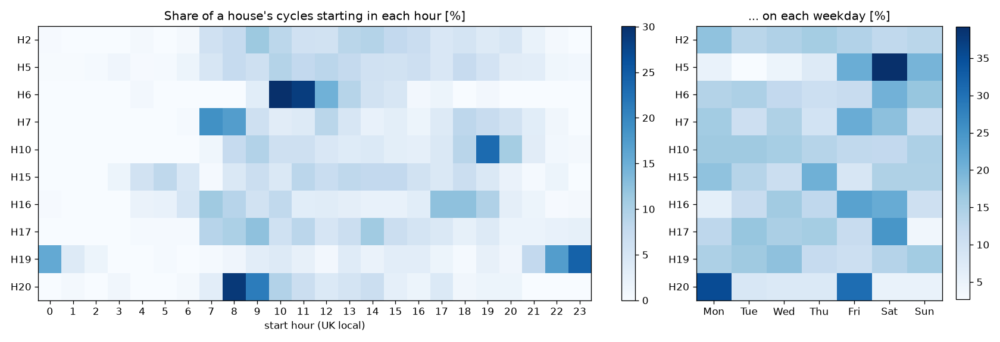
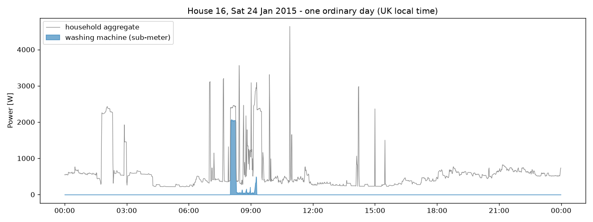
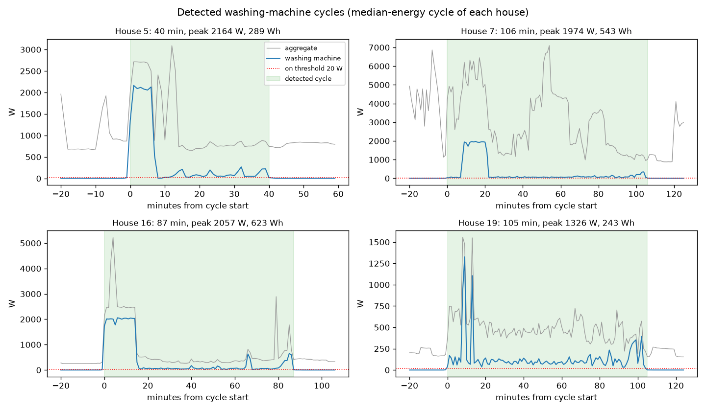
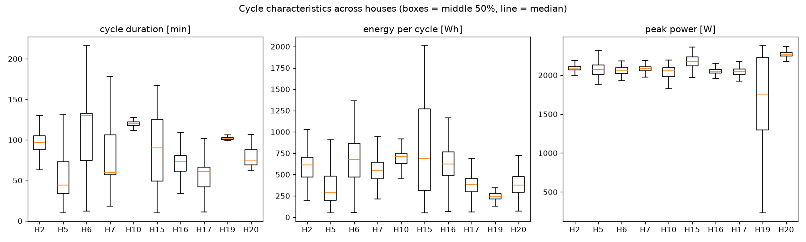
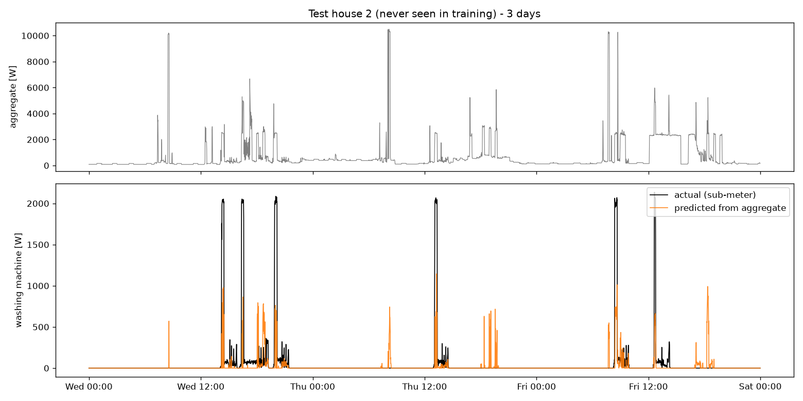
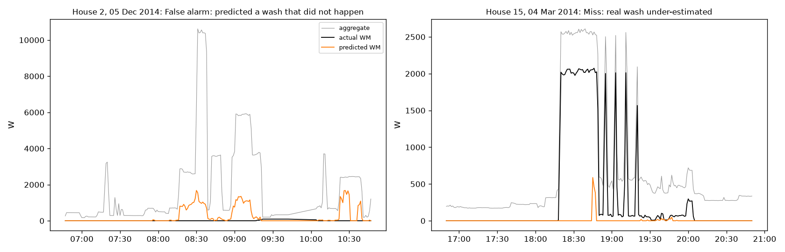

# RESULTS.md — washing-machine EDA and disaggregation model

All numbers come from files in `outputs/`, and all plots are in `figures/`. Time of day is **UK local time**.

---

## Part A — Section 2: washing-machine EDA (official cleaned data, 1-minute)

### Homes and periods
We used **10 homes: 2, 5, 6, 7, 10, 15, 16, 17, 19, 20**, each over its full record. The earliest start is 2013-09-17 and the latest end is 2015-07-08, giving 460–648 days per home. The exact dates, missing data, stuck-sensor minutes and `Issues` share for each home are in `DATA.md` §4 (`outputs/s2_availability.csv`).

Why these homes: each has one washing machine, and no solar panels, no washer-dryer and no machine replacement.

### Rule for an active cycle (plain language)
1. **On:** a minute counts as "on" when the machine draws **more than 20 W**. Standby is under 5 W. The 20 W threshold is the washing-machine on-threshold used by Zhang et al. (2018).
2. **Pauses are joined:** "on" minutes separated by a pause of **10 minutes or less** belong to the same wash, because machines pause to soak, drain and refill.
3. **Size check:** a group counts as a wash only if it lasts **at least 10 minutes** and uses **at least 50 Wh**. This drops door-lock blips and single spikes, which are mostly 1–2 minutes long and about 5 Wh.
4. **Upper limit:** a group longer than **6 hours** is not counted. It is either back-to-back loads or a faulty sensor; only 8 groups were affected, all in House 5.

**Result: 3,931 cycles.**
- Median duration **75 min**, median energy **515 Wh**, median peak **2,077 W**.
- **93%** of cycles reach at least 1.5 kW: the water-heater block is the machine's main "fingerprint".

### Availability and data quality
Per home (`outputs/s2_availability.csv`; the `Issues` share and stuck-sensor minutes are in `DATA.md` §4):

| House | WM channel | Period (UTC) | Missing minutes | Gaps ≥ 1 h | Longest gap (days) | WM exactly 0 W | WM off (≤ 20 W) | Cycles | Cycles / week |
|---|---|---|---|---|---|---|---|---|---|
| 2 | Appliance2 | 2013-09-17 – 2015-05-28 | 24.6% | 80 | 62.0 | 94.4% | 95.3% | 335 | 5.04 |
| 5 | Appliance3 | 2013-09-26 – 2015-07-06 | 11.4% | 274 | 8.6 | 53.4% | 94.4% | 712 | 8.68 |
| 6 | Appliance2 | 2013-11-28 – 2015-06-28 | 15.2% | 22 | 33.6 | 97.4% | 98.1% | 123 | 1.76 |
| 7 | Appliance5 | 2013-11-01 – 2015-07-08 | 12.6% | 27 | 41.6 | 74.9% | 91.6% | 855 | 11.16 |
| 10 | Appliance5 | 2013-11-20 – 2015-06-30 | 11.2% | 214 | 8.6 | 90.2% | 91.3% | 603 | 8.1 |
| 15 | Appliance3 | 2013-12-17 – 2015-07-08 | 13.7% | 205 | 8.6 | 96.2% | 97.1% | 257 | 3.67 |
| 16 | Appliance5 | 2014-01-10 – 2015-07-08 | 17.3% | 205 | 18.1 | 93.3% | 96.3% | 315 | 4.91 |
| 17 | Appliance4 | 2014-03-06 – 2015-06-19 | 6.2% | 16 | 8.6 | 96.6% | 97.6% | 283 | 4.49 |
| 19 | Appliance2 | 2014-03-06 – 2015-06-20 | 6.5% | 15 | 8.6 | 86.6% | 96.1% | 255 | 4.06 |
| 20 | Appliance4 | 2014-03-20 – 2015-06-23 | 6.0% | 13 | 8.6 | 97.2% | 97.6% | 193 | 3.12 |

Summary:

| | Range across the 10 homes |
|---|---|
| Missing minutes | 6.0% (House 20) – 24.6% (House 2) |
| Machine off (≤ 20 W) | 91.3% – 98.1% of measured minutes |
| Cycles per week | 1.8 (House 6) – 11.2 (House 7) |
| Washing machine's share of household energy | 1.5% – 6.8% |

Data faults found:
- House 5's washing-machine plug was **stuck at one fixed value for 19,599 minutes** (about 13.6 days in total). These minutes were removed.
- Houses 15 and 20 had a few stuck minutes (225 and 98).
- There is a probable **1-hour clock offset** in the official files in summer 2015. It affects start-hour plots by up to +1 h for ~3 months of data (`DATA.md` §5).

### Usage patterns: `figures/s2_usage_hour_dow.png`

Each row is one home. Colour shows the share of that home's washes **starting** in each hour (left) or on each weekday (right).

- **Most homes wash in the morning to midday.** 7:00–13:00 accounts for 31–77% of starts in every home except House 19, the night washer, at 12% (`outputs/s2_start_hour_pct.csv`).
- **Each home has its own habit:**
  - House 19 washes mostly **at night**: 71% of starts are between 21:00 and 06:00, which suggests a delay timer or a night tariff.
  - House 10 has a strong **19:00** peak.
  - House 16 washes **17:00–18:00** (27% of its starts fall in the weekday 16:00–19:00 peak).
  - Houses 6 and 20 wash mostly in the **morning**: about three-quarters of their starts fall between 7:00 and 13:00, peaking at 8:00–11:00.
- **Weekdays:**
  - House 5 does 38% of its washes on **Saturday**.
  - House 20 washes on **Monday** (35%) and **Friday** (31%).
  - Houses 2, 10 and 19 are spread evenly across the week.
- **Evening peak:** on average only **9.6%** of washes start in the weekday 16:00–19:00 peak (`outputs/s2_peak_exposure.csv`).

### Plot (i): a representative 24 hours: `figures/s2_trace_24h.png`

House 16, Saturday 24 Jan 2015, chosen automatically. It is a complete day with exactly one wash whose energy is closest to the house's median.

The wash starts at about 08:00. It begins with a **~15-minute, ~2 kW heating block**, followed by about an hour of **low, flickering drum power**, and ends with short spin peaks.

The grey aggregate shows the challenge for disaggregation. The same 2 kW block sits on top of the house's background load, while other appliances create **similar 2–4.7 kW spikes** (probably a kettle or cooking, at 07:00, 07:40 and 10:50). Those spikes are short and flat, without the drum flicker that follows a wash.

### Plot (ii): detected cycles: `figures/s2_detected_cycles.png`

The median-energy cycle of four homes. The green band is the detected cycle, and the red dotted line is the 20 W rule.

- The detector covers the whole wash, including the low-power drum phase after heating. That is why the 10-minute pause rule matters: without it, one wash would be cut into many pieces.
- **The programmes differ:**
  - House 5's median wash is short (40 min, 289 Wh).
  - Houses 7 and 16 run longer programmes (87–106 min, 540–620 Wh).
  - House 19's typical wash has only **brief 1.1–1.3 kW bursts** and uses 243 Wh, which suggests a cooler, lower-energy programme.

### Plot (iii): cross-house comparison: `figures/s2_cross_house.png`

`outputs/s2_cycle_stats.csv`:

| House | Cycles | Median duration (min) | Median peak (W) | Median energy (Wh) |
|---|---|---|---|---|
| 2 | 335 | 97 | 2,090 | 612 |
| 5 | 712 | 44 | 2,072 | 289 |
| 6 | 123 | 130 | 2,055 | 673 |
| 7 | 855 | 60 | 2,083 | 543 |
| 10 | 603 | 120 | 2,056 | 711 |
| 15 | 257 | 90 | 2,180 | 687 |
| 16 | 315 | 73 | 2,050 | 623 |
| 17 | 283 | 61 | 2,045 | 380 |
| 19 | 255 | 102 | 1,759 | 243 |
| 20 | 193 | 74 | 2,272 | 376 |

What the comparison shows:
- **Peak power is almost the same everywhere** (about 2.0–2.3 kW), because it is set by the heater element. House 19 is the exception, with a wide spread because many of its washes never reach full heater power.
- **Energy per wash differs by about 3×** between homes (median 243 Wh in House 19 to 711 Wh in House 10), and duration by about 3× (44 to 130 min). That reflects the programmes and temperatures people choose, not the machine's maximum power.
- **Some homes are very consistent.** House 10's interquartile range of duration is just 4 min; House 19's is 2 min. In other words, the same programme every time.
- **Others vary a lot.** In House 15 the energy interquartile range is 955 Wh, which is consistent with a mix of cooler and hotter programmes.

---

## Part B — Section 3: disaggregation model

### Task, homes and periods
- **Task:** estimate washing-machine power (W) at each minute from the **household aggregate** at 1-minute resolution.
- **Data:** official cleaned REFIT data, each home's full record (dates in `DATA.md` §4).
- **Minutes used:** those with both aggregate and washing-machine readings, `Issues` = 0 and no stuck sensor. That gives **train 4,175,676**, **validation 1,221,273** and **test 1,350,479** minutes.

| Set | Home | Period used (UTC) | Minutes used |
|---|---|---|---|
| Train | 5 | 2013-09-26 – 2015-07-06 | 764,320 |
| Train | 6 | 2013-11-28 – 2015-06-28 | 690,185 |
| Train | 7 | 2013-11-01 – 2015-07-08 | 736,091 |
| Train | 10 | 2013-11-20 – 2015-06-30 | 736,611 |
| Train | 16 | 2014-01-10 – 2015-07-08 | 640,853 |
| Train | 19 | 2014-03-06 – 2015-06-20 | 607,616 |
| Validation | 17 | 2014-03-06 – 2015-06-19 | 607,947 |
| Validation | 20 | 2014-03-20 – 2015-06-23 | 613,326 |
| **Test** | **2** | 2013-09-17 – 2015-05-28 | 656,706 |
| **Test** | **15** | 2013-12-17 – 2015-07-08 | 693,773 |

### Validation design (avoids leakage)
| Set | Homes | Used for |
|---|---|---|
| Train | 5, 6, 7, 10, 16, 19 | fitting |
| Validation | 17, 20 | early stopping and picking one variant |
| **Test** | **2, 15** | **final numbers, used once** |

- **We split by household, not by random minutes.** Neighbouring minutes are nearly identical, and each prediction looks at a window of up to ±120 minutes, so a random split would put near-copies of test examples into training.
- **With a household split, nothing from a test home is seen in training:** no minutes, no windows, no habits.
- **It also matches the real use case,** which is a utility applying the model to **new customers** who have no plug monitors.
- Test homes were fixed before modelling to cover different households: House 2 has 4 occupants and many kitchen appliances; House 15 has 1 occupant.

### Model
The idea is **sequence-to-point** (Zhang et al., 2018): to estimate the washing machine at minute *t*, look at the aggregate around *t*: most features use *t − 60* to *t + 60* min, and a few long summaries use ±120 min.

The window is summarised into **66 features**:
- level, lags and leads
- step changes
- rolling mean, std, max and min (5–121 min)
- power above the window minimum (removes the home's base load)
- counts of minutes above 1.8 kW (15–241 min) and the length of the current high-power block
- **"agitation"**: mean absolute minute-to-minute change over 15–241 min, which captures the drum turning back and forth after heating
- hour of day and weekend

These features feed **LightGBM** (gradient-boosted decision trees). It is fast on a CPU, handles missing minutes on its own, and its feature use can be inspected.

**Variants compared on validation** (`outputs/s3_validation_choice.csv`). The selection rule was fixed in advance: **best validation F1**.

| Variant | MAE (W) | SAE | Daily energy MAE (Wh/day) | Precision | Recall | F1 |
|---|---|---|---|---|---|---|
| **Two-stage: P(on) > 0.2 × regressor** ← chosen | 6.49 | 0.51 | **109** | 0.46 | 0.40 | **0.43** |
| Two-stage, P(on) > 0.3 | 6.15 | 0.62 | 111 | 0.53 | 0.33 | 0.41 |
| Regressor, Huber loss | 7.80 | 0.53 | 130 | 0.32 | 0.48 | 0.38 |
| Two-stage, P(on) > 0.4 | 5.96 | 0.71 | 115 | 0.59 | 0.26 | 0.36 |
| Regressor, L2 loss, + clock features | 8.81 | **0.01** | 118 | 0.27 | 0.56 | 0.36 |
| Regressor, L2, aggregate-only | 8.87 | 0.03 | 122 | 0.26 | 0.55 | 0.35 |
| Two-stage, P(on) > 0.5 | 5.89 | 0.79 | 121 | 0.64 | 0.20 | 0.30 |
| Regressor, L1 loss | 6.35 | 1.00 | 144 | 0 | 0 | 0 |
| *(always off, for reference)* | *6.34* | *1.00* | *144* | *0* | *0* | *0* |

How the chosen model works:
- **Stage 1** is a classifier that gives the probability the machine is running (> 20 W).
- **Stage 2** is the L2 regressor that estimates the watts.
- The prediction is the Stage 2 value if P(on) > 0.2, and 0 otherwise.

What we learned from the comparison:
- **The L1 loss collapses to always predicting 0.** For a machine that is off about 95% of the time, the median is 0, so this is the "optimal" answer under L1 and useless in practice.
- This is also why **we do not select on MAE**: always-off already scores well on it.
- The **L2 regressor** gets total energy right on validation (SAE ≈ 0.01) but produces many false "on" minutes (precision 0.27).
- The **two-stage gate** raises precision substantially (0.27 → 0.46 on validation), at the cost of under-estimating energy.
- Features with the most weight:
  - Classifier: `agitation15` (35% of gain), which suggests that drum flicker is the main cue separating a wash from a kettle.
  - Regressor: `min5` (15%) and `high_block_len` (8%), i.e. how big and how long the heating block is (`outputs/s3_feature_importance.csv`).

### Baselines and metrics
**Baselines**
1. **Always off:** predicts 0 W.
2. **Hour-of-week profile:** the average washing-machine power for that weekday and hour across the training homes.

**Metrics**
| Metric | What it tells you | Why we use it |
|---|---|---|
| **MAE** (W) | Average error per minute | The standard NILM metric (Zhang et al.; D'Incecco et al.). But it rewards predicting 0 for rarely used appliances. |
| **SAE** | \|predicted − true total energy\| / true total energy | Answers "how much did the machine use overall?" |
| **Daily energy MAE** (Wh/day) | Error in the daily washing-machine energy | What an insight or report shown to a customer would display |
| **Precision / Recall / F1** for "on" (> 20 W) | Did we find the minutes when the machine runs, without false alarms? | Exposes always-off, which has F1 = 0 |
| **Cycle level** | Fraction of real washes the model finds, and false washes per week | The Section 2 cycle rule applied to predictions; this is what a "wash detector" product would deliver |

### Test results: homes 2 and 15, never seen before (`outputs/s3_metrics.csv`)

| Method | MAE (W) | SAE | Daily energy MAE (Wh/day) | Precision | Recall | F1 |
|---|---|---|---|---|---|---|
| Always off | 14.01 | 1.00 | 308 | 0 | 0 | 0 |
| Hour-of-week profile | 30.62 | 0.29 | 382 | 0.04 | 0.52 | 0.07 |
| Regressor (L2, single stage) | 15.82 | 0.29 | **226** | 0.35 | 0.63 | 0.45 |
| **Two-stage model (chosen)** | **13.72** | 0.56 | 237 | **0.53** | 0.42 | **0.46** |

For reference, the true average is 308 Wh of washing-machine energy per day in the test homes.

**Per home (chosen model):**

| Home | MAE | SAE | F1 | Real washes found | Predicted washes that are real | False washes / week |
|---|---|---|---|---|---|---|
| 2 | 19.3 | 0.47 | 0.34 | 54% | 39% | **4.4** |
| 15 | 8.5 | 0.68 | **0.72** | 62% | **92%** | **0.2** |

(cycle-level columns from `outputs/s3_cycle_level.csv`)

Caveat on the cycle-level numbers: they are computed on evaluation minutes only. Minutes with an `Issues` flag or a missing reading are removed. A real wash that contains such minutes can therefore be split or shortened, for both the true and the predicted series. The counts are therefore approximate.

**How to read these results**
- **Beating the baselines.** The chosen model beats both baselines on MAE, daily energy error and F1. It also has the highest precision for wash minutes (0.53).
  - Against always-off, the MAE gain is small (13.7 vs 14.0 W). That is expected for a rarely used appliance.
  - The gain is large on F1 (0.46 vs 0) and on daily energy error (237 vs 308 Wh/day).
- **Energy is under-estimated** (SAE 0.56; predicted washes contain about 180–200 Wh against a true median of 430–560 Wh). The gate removes uncertain minutes, and the regressor predicts the heater block at about half height (see the plot below).
  - If total energy is the goal, the **single-stage regressor** is the better tool: SAE 0.29, daily error 226 Wh/day.
  - This is a genuine trade-off between **detecting washes** and **measuring energy**, and we report both rather than hide it.
- **The model works much better in some homes than others:**
  - House 15 (1 occupant): 92% of detected washes are real, with fewer than one false wash every 5 weeks.
  - House 2 (4 occupants, many 2–3 kW kitchen loads): 4.4 false washes per week.
- **For context**, D'Incecco et al. (2020) report a REFIT washing-machine SAE of 2.61 (a 261% energy error) for a CNN tested on an unseen home at 8-second resolution. Unseen-home washing-machine disaggregation is hard in general.

### Actual vs predicted: `figures/s3_actual_vs_predicted.png`

Test House 2, the 3 days with the most washing.

- **Every real wash is flagged at the right time.** Wednesday 14:00, 16:00 and 20:00; Thursday 13:00; Friday 09:00 and 12:30.
- **The predicted heating block is too low:** about 600–1,200 W instead of about 2,000 W. That explains the under-estimated energy.
- **There are false alarms.** Thursday 08:00 and 18:00, and Friday 18:00, coincide with other high-power activity (about 2–10 kW) in the aggregate that is not the washing machine.

Also see `figures/s3_daily_energy_scatter.png`. Most days fall below the diagonal (under-estimated), and there is a column of House 2 days at true 0 with predicted energy above 0 (false washes).

### Failure cases: `figures/s3_failure_cases.png`

1. **False alarm in House 2 (left).** On a December morning the aggregate shows a 10 kW block (likely an electric shower) and several 2.7–6 kW blocks lasting 10–25 min, with appliances switching around them. Long ~2–3 kW blocks surrounded by on/off activity look like a heating phase followed by agitation, so the model predicts a wash; the sub-meter shows none. Its cues are **"a ~2 kW block lasting a while" and "flicker nearby"**, and a dishwasher, oven or tumble dryer can produce both. This is the **overlapping-signature** problem, and it is likely the main reason House 2 does worse.
2. **Miss in House 15 (right).** A real wash heats at about 2.1 kW for **about 35–40 minutes**, much longer than the 7–15-minute heating blocks of the median cycles in Section 2 (Plot ii); this is likely a hot programme. The model predicts only about 0.5–1 kW during heating, and almost nothing during the drum phase that follows. **Programmes that are rare in the training homes** (hot washes, very long or very short cycles) are under-estimated or missed.

**Other situations where the model is likely to struggle**
- **Cold washes** with no heater block, because the remaining motor load (50–500 W) is lost among fridges, TVs and computers.
- **Homes with a washer-dryer or a tumble dryer** running straight after the wash.
- **Washes during outages, or split by them.**
- **Homes whose habits differ from the training homes.** The clock features help on average but can mislead, for example for a night-time washer like House 19.

### What we would do next (and why)
1. **Leave-one-home-out cross-validation** over all 10 homes. Two test homes give a range, not a reliable average.
2. **A Seq2Point CNN on a GPU, on the same split.** Learned shape features may separate washing machines from dishwashers better than hand-made summaries.
3. **Recalibrate the regressor's amplitude** (for example, fit the heater level per detected cycle), so that energy is not under-estimated when the gate is on.
4. **Add training homes with dishwashers and tumble dryers**, and include their labels as "hard negatives" (examples the model must learn to reject), to cut false alarms like House 2's.
